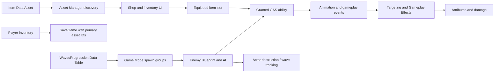

# Content authoring documentation

These guides describe the **actual Community Upgrade sample** on Unreal Engine 5.8.4. They do not assume the proposed Community Mod, PCG dungeon manager, multiplayer, or IGF integration exists.

## Start here

1. Follow the root [README](../README.md) to build and open `ActionRPG.uproject`.
2. Start play from `/Game/Maps/ActionRPG_Main` to exercise the original menu/save setup.
3. Read [Adding items](ADDING_ITEMS.md) for weapon, skill, potion, token, shop, pickup, inventory, and GAS authoring.
4. Read [Adding enemies](ADDING_ENEMIES.md) for goblin variants, new meshes/skeletons, attacks, AI, rewards, and original wave-table integration.
5. Follow each guide's editor, save/reload, and packaged-build checks before distributing new content.

## The sample's data flow



The native item definitions are Data Assets, while character, weapon actor, ability, AI, and most gameplay logic are Blueprint-based. Inherited class comments occasionally use “blueprint” broadly; follow the concrete asset examples and native behavior described in the guides.

## Inspect the source content yourself

The editor-only `RPGInspectContent` commandlet exports asset defaults, Blueprint graph nodes/pin links, progression table rows, and montage notifies. It does not save packages or create gameplay content.

```powershell
$editor = 'C:/Program Files/Epic Games/UE_5.8/Engine/Binaries/Win64/UnrealEditor-Cmd.exe'
$project = (Resolve-Path './ActionRPG.uproject').Path
& $editor $project -run=RPGInspectContent -unattended -nop4 -NullRHI -nosound
```

Build the editor target first. The output is `Saved/DocsInspection.txt`; this generated report is ignored by Git. It is useful for comparing inherited defaults when a duplicate behaves differently from its parent. It is diagnostic evidence, not an importable asset format.

## Other references

- [Migration notes and validation limits](MIGRATION_NOTES.md)
- [Contributing and reporting bugs](../CONTRIBUTING.md)
- [Licensing and attribution](../LICENSE.md)
- [Epic's original ActionRPG gameplay documentation](https://dev.epicgames.com/documentation/en-us/unreal-engine/building-gameplay-in-cplusplus-for-action-rpg?application_version=4.27)

The 4.27 documentation explains the original architecture; use the guides in this repository for the 5.8 cooldown-component and migration details.
